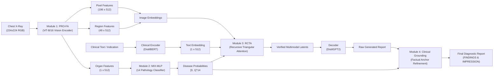

# 🤖 AI Agent & Developer Guide: Cognitive Radiology Assistant

Welcome to the **Cognitive Radiology Assistant** repository!
This guide is specifically written for AI coding agents (**Claude, Codex, Antigravity, Cursor, Devin**, etc.) and developers who have cloned this repository and need to understand, run, test, extend, or debug the codebase quickly and reliably.

---

## ⚡ 1. Quickstart Commands (TL;DR)

Everything in this repository is managed through the unified master runner [`run.py`](file:///d:/ChestXRAY/run.py) (or `.\run.ps1` on Windows / `./run.sh` on Unix):

```bash
# 1. Automatic Environment & Dependencies Setup
python run.py --setup

# 2. Complete System & Model Healthcheck
python run.py --check

# 3. Download the 3GB Trained Model Checkpoint (Parallel multi-threaded)
python run.py --download-model

# 4. Generate Diagnostic Radiology Report for a Test Chest X-Ray
python run.py --demo

# 5. Launch Interactive Desktop GUI (PySide6)
python run.py --gui

# 6. Run Architectural & Unit Tests
python run.py --test
```

---

## 🧠 2. Core Architecture Overview

The system implements a four-stage vision-language diagnostic pipeline:



### Module Breakdown:

1. **Module 1: PRO-FA (Progressive Feature Alignment)** – [`models/encoder.py`](file:///d:/ChestXRAY/models/encoder.py)
   - Visual backbone: `ViT-B/16` (`vit_base_patch16_224`).
   - Extracts hierarchical representations:
     - **Pixel level:** $196 \times 512$
     - **Region level:** $49 \times 512$ via adaptive 2D pooling
     - **Organ level:** $1 \times 512$ (pooled holistic feature)

2. **Module 2: MIX-MLP (Multi-task Knowledge-Enhanced MLP)** – [`models/classifier.py`](file:///d:/ChestXRAY/models/classifier.py)
   - Takes the organ-level visual embedding ($1 \times 512$).
   - Predicts independent probabilities for **14 CheXpert pathologies**:
     `No Finding`, `Enlarged Cardiomediastinum`, `Cardiomegaly`, `Lung Opacity`, `Lung Lesion`, `Edema`, `Consolidation`, `Pneumonia`, `Atelectasis`, `Pneumothorax`, `Pleural Effusion`, `Pleural Other`, `Fracture`, `Support Devices`.

3. **Module 3: RCTA (Recursive Cognitive Triangular Attention)** – [`models/attention.py`](file:///d:/ChestXRAY/models/attention.py)
   - Performs tri-modal cognitive fusion between **Image features**, **Clinical indication features** (encoded via DistilBERT), and **Disease scores** (projected from MIX-MLP).
   - Generates verified conditioning features ($1 \times 512$).

4. **Module 4: Clinical Grounding & Inference Safety** – [`scripts/generate_reports.py`](file:///d:/ChestXRAY/scripts/generate_reports.py#L22)
   - Post-generation factual anchoring.
   - Cross-checks decoder sentences against the pathology probability thresholds to prevent medical hallucinations and enforce clinical correctness.

---

## 📁 3. Repository Directory Structure

```
D:\ChestXRAY/
├── run.py                     # Master CLI runner for all tasks (setup, check, demo, gui, etc.)
├── run.ps1                    # Windows PowerShell shortcut
├── run.sh                     # Linux / macOS shell shortcut
├── requirements.txt           # Python package dependencies
├── AGENT_GUIDE.md             # This agent & developer manual
├── README.md                  # Project overview and hackathon documentation
├── models/                    # Core PyTorch model architectures
│   ├── encoder.py             # Module 1: PRO-FA ViT encoder
│   ├── classifier.py          # Module 2: MIX-MLP disease classifier
│   ├── attention.py           # Module 3: RCTA triangular cross-attention
│   ├── cognitive_model.py     # Top-level CognitiveReportGenerator model
│   └── dataset.py             # PyTorch dataset & transforms (IU X-Ray & MIMIC-CXR)
├── checkpoints/               # Trained model weights directory
│   ├── best_model.pth         # 3GB trained weights file
│   └── best_model.pth.progress.json  # Checkpoint resume tracker
├── data/                      # Dataset root
│   └── sample_images/         # Public sample chest X-rays for zero-setup demo
├── scripts/                   # Utility and execution scripts
│   ├── download_checkpoint.py # High-speed parallel Mega checkpoint downloader
│   ├── create_sample_data.py  # Sample image downloader / generator
│   ├── generate_reports.py    # Report generation inference script
│   ├── gui_app.py             # PySide6 desktop GUI demo
│   ├── preprocess_iu_xray.py  # IU X-Ray data preprocessor
│   ├── preprocess_mimic.py    # MIMIC-CXR data preprocessor
│   ├── download_mimic.py      # MIMIC-CXR dataset downloader
│   └── download_with_hub.py   # HuggingFace dataset downloader
├── training/
│   └── train.py               # Complete training loop with mixed precision & checkpointing
├── evaluation/
│   └── evaluate.py            # Evaluation benchmark (BLEU, CheXpert, RadGraph, CIDEr)
├── tests/
│   └── test_model.py          # Unit & smoke tests for model modules
└── docs/                      # Original hackathon paper & submission reference
    ├── BrainDead_Team_monikabhati2005.pdf
    └── submission.txt
```

---

## ⚙️ 4. Environment & Compute

- **Python Version:** 3.10, 3.11, or 3.12.
- **CUDA Acceleration:** NVIDIA GeForce RTX 3050 (or any modern GPU with CUDA 12.x).
  - PyTorch CUDA command: `pip install torch torchvision --index-url https://download.pytorch.org/whl/cu124`
- **CPU Fallback:** Fully supported. If CUDA is not detected, `device = torch.device('cpu')` is automatically used.
- **Mixed Precision:** Uses `torch.amp.autocast('cuda')` during training and inference when running on GPU.

---

## 💾 5. Model Weights & Checkpoint Management

The trained model checkpoint (`best_model.pth`, ~2.86 GB) contains:
- `model_state_dict`: Weights for ViT-B/16 PRO-FA, MIX-MLP, RCTA, and DistilGPT2.
- `optimizer_state_dict`: Training state (for resuming training).
- `epoch` and `loss` metrics.

### Automatic Parallel Download:
Run the built-in multi-threaded downloader:
```bash
python run.py --download-model
# Or specify worker threads:
python scripts/download_checkpoint.py --workers 10
```
- Uses **10 parallel threads** with HTTP Range requests.
- Implements AES-128-CTR chunk decryption on-the-fly.
- Automatically saves state in `checkpoints/best_model.pth.progress.json` and supports resuming from interruptions.
- Verifies the PyTorch ZIP archive header (`PK\x03\x04`) upon completion.

### Manual Download Link:
If direct download is preferred, fetch the file from:
- [Mega.nz Mirror](https://mega.nz/file/azh1iAxK#9dlcjr4OUYtOixJXeKcaXTEy5hsvUw7CfVlXHrrYjjU)
- Place into: `checkpoints/best_model.pth`

---

## 🔬 6. Programmatic Python API

To run inference from within an agent script or Python application:

```python
import torch
from PIL import Image
from transformers import AutoTokenizer
from models.cognitive_model import CognitiveReportGenerator
from scripts.generate_reports import generate_report

# 1. Setup device
device = torch.device('cuda' if torch.cuda.is_available() else 'cpu')

# 2. Instantiate model and load checkpoint
model = CognitiveReportGenerator(
    visual_encoder='vit_base_patch16_224',
    text_encoder_name='distilbert-base-uncased',
    decoder_name='distilgpt2',
    num_diseases=14,
    hidden_dim=512
)
checkpoint = torch.load('checkpoints/best_model.pth', map_location=device)
model.load_state_dict(checkpoint['model_state_dict'])
model.to(device).eval()

# 3. Load tokenizers
enc_tok = AutoTokenizer.from_pretrained('distilbert-base-uncased')
dec_tok = AutoTokenizer.from_pretrained('distilgpt2')
if dec_tok.pad_token is None:
    dec_tok.pad_token = dec_tok.eos_token

# 4. Generate report
image_path = 'data/sample_images/sample_normal_adult_pa.png'
report, disease_probs = generate_report(
    model=model,
    image_path=image_path,
    enc_tokenizer=enc_tok,
    dec_tokenizer=dec_tok,
    device=device,
    indication_text="Clinical indication: Chest pain."
)

print("Generated Report:\n", report)
print("Pathology Probabilities:\n", disease_probs)
```

---

## 🧪 7. Running Tests

Run the test suite to verify dimensions and module interaction:
```bash
python run.py --test
# Or directly:
python -m unittest tests/test_model.py
```
Tests included:
1. `test_profa_encoder`: Checks pixel ($196 \times 512$), region ($49 \times 512$), and organ ($1 \times 512$) tensor outputs.
2. `test_mix_mlp`: Checks logits shape ($B \times 14$).
3. `test_rcta`: Checks tri-modal cross-attention fusion shape ($B \times 1 \times 512$).
4. `test_full_model_forward`: Verifies loss calculation and forward pass.

---

## 🏋️ 8. Training & Fine-Tuning

To train on IU X-Ray or MIMIC-CXR:

```bash
# 1. Preprocess dataset
python scripts/preprocess_iu_xray.py
# or:
python scripts/preprocess_mimic.py

# 2. Start training
python run.py --train --dataset iu_xray --batch_size 8 --epochs 15 --lr 1e-4

# 3. Resume training from a saved checkpoint
python run.py --train --resume checkpoints/latest_model.pth --batch_size 8 --epochs 15
```

---

## 📊 9. Evaluation

Run the evaluation benchmark on the test split:
```bash
python run.py --eval --dataset mimic_cxr --checkpoint checkpoints/best_model.pth --batch_size 32
```
Metrics computed:
- **Clinical F1 (CheXpert 14):** Evaluates diagnostic pathology precision and recall.
- **RadGraph F1:** Evaluates clinical entity and relation extraction.
- **CIDEr & BLEU-4:** Linguistic fluency and overlap with reference reports.

---

## 🛠️ 10. Agent Troubleshooting Guide

| Issue | Cause | Resolution |
|-------|-------|------------|
| `ModuleNotFoundError: No module named 'models'` | Python not finding project root | Ensure current working directory is project root or run via `python run.py ...` |
| `FileNotFoundError: checkpoints/best_model.pth` | Model weights not downloaded | Run `python run.py --download-model` |
| `Resource punkt_tab not found` | NLTK missing tokenizers | Run `python -c "import nltk; nltk.download('punkt'); nltk.download('punkt_tab'); nltk.download('wordnet')"` |
| `CUDA out of memory` | GPU VRAM exceeded on large batch size | Reduce `--batch_size` (e.g. from 16 to 4 or 2) in `train.py` |
| `OSError: [WinError 4551] Application Control policy blocked file` | Windows WDAC/AppLocker blocking `.pyd` in local folder | Run using the trusted Anaconda interpreter `D:\Anaconda3\python.exe` |
